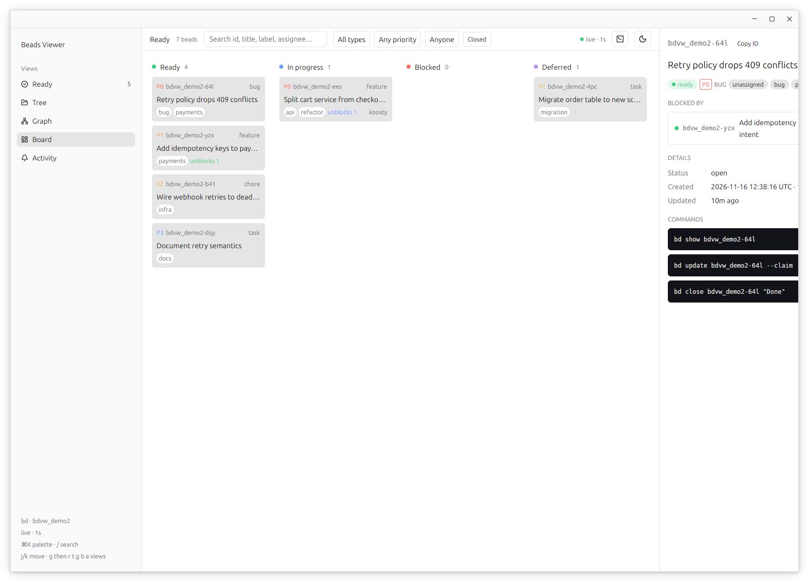
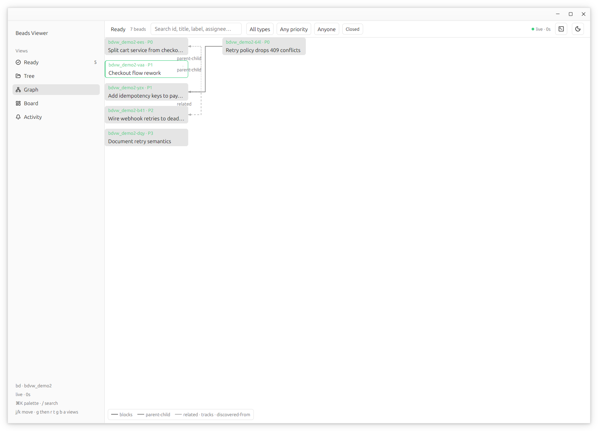
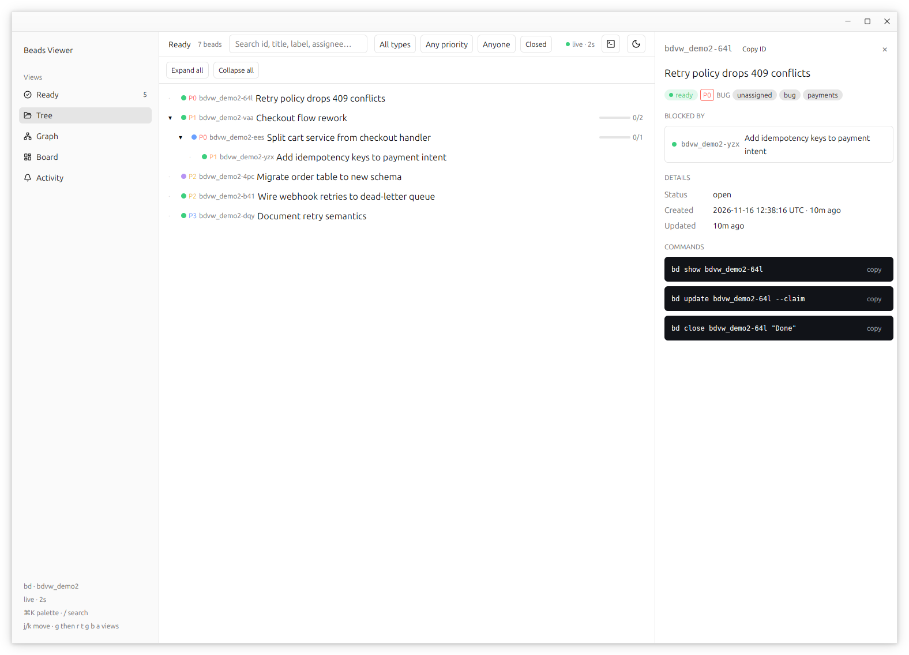
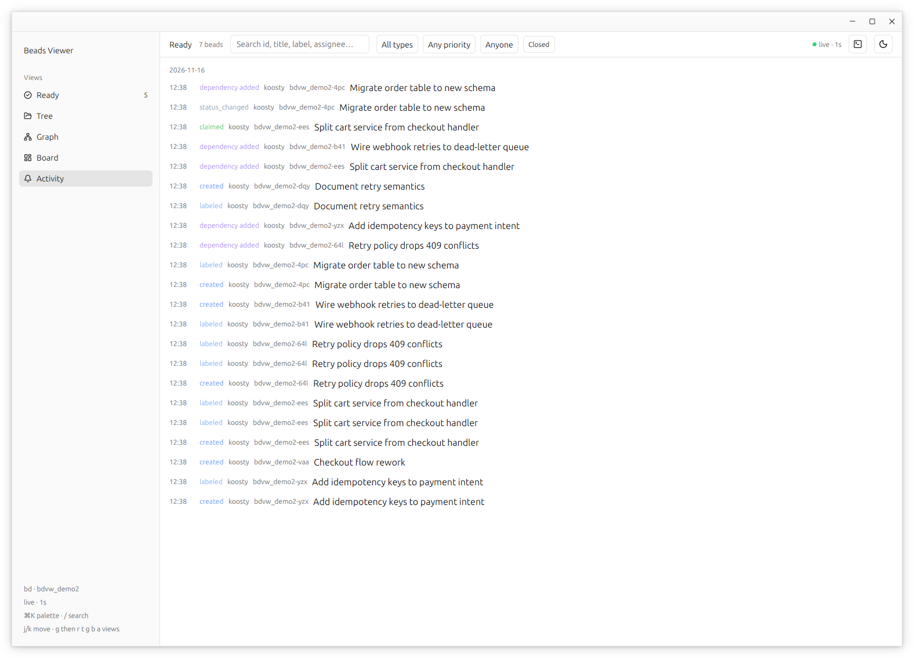
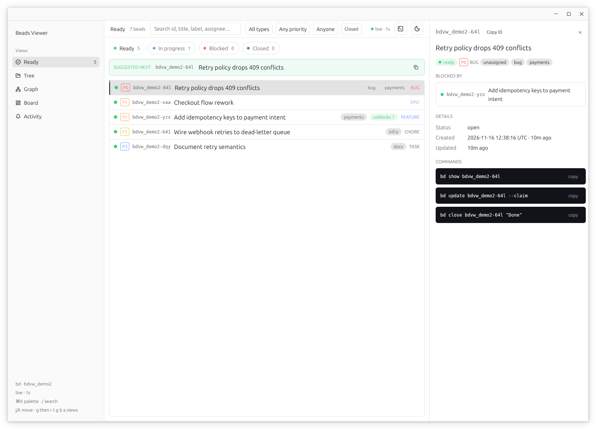

# bdvw — Beads Viewer

A desktop UI for supervising [bd (beads)](https://github.com/gastownhall/beads) issue-tracker work driven by agents. Rust + [gpui](https://github.com/zed-industries/zed) via `gpui-kit`.

`bd` is built for agents working in parallel. Its CLI answers one question at a time. This is the cockpit: every bead in one window, live-updating as agents claim, block, and close work.

<!-- screenshots -->



## What it does

- **Ready** — work ranked by priority, with a suggested next bead and one-click claim commands.
- **Tree** — dependency hierarchy with epic progress and ancestor retention under filters.
- **Board** — kanban over derived state, closed column capped at 30.
- **Activity** — event timeline across all beads, grouped by day, color-coded by event kind.
- **Detail drawer** — full record, blocked-by/blocks/related links, copy-to-clipboard commands.
- **Live sync** — polls `bd` every 2 s; drawer and graph refresh only on change.
- **Graph** — layered DAG with pan/zoom/fit, epic collapse, hover focus.

## Requirements

- Linux with Wayland (X11 untested)
- Rust 1.92+ (gpui-kit and its dependencies require edition 2024; developed on 1.100, verified on 1.95)
- `bd` 1.3+ on `PATH` — the viewer shells out to it, never opens the database

## Install

From crates.io:

```bash
cargo install bdvw
```

From source:

```bash
git clone https://github.com/koosty/bdvw.git
cd bdvw
cargo build --release
./target/release/bdvw
```

Point it at a workspace other than the current directory:

```bash
bdvw --dir /path/to/project
```

`--dir` canonicalizes the path, rejects non-directories, and exits 2 on bad arguments. `bdvw --help` prints usage.

## Keys

| Key | Action |
| --- | --- |
| `Ctrl/Cmd+K`, `/` | Command palette |
| `g` then `r`/`t`/`g`/`b`/`a`/`m` | Ready / Tree / Graph / Board / Activity / Memory |
| `j` / `k` | Move selection |
| `Enter` | Open selected bead in the drawer |
| `Esc` | Close the drawer |

Keys route to the active view. Plain keys are ignored while a text input has focus. The palette also jumps to any bead by ID or title, and toggles the theme.

## Status

`0.1.0-alpha.1` — first public alpha. Read-only: the viewer never writes to your bead database. See [CHANGELOG.md](CHANGELOG.md) for the full scope and known limitations.

Known issues:

- **Memory and Messages views** — `g m` shows a placeholder; the slice isn't built.
- **In-app writes** — claim/close are copyable commands, not buttons.
- **Workspace switching** — requires a restart with `--dir`.

Screenshots come from a synthetic demo workspace:






## Notes on `bd` behavior

- `bd list --json` omits closed beads; the viewer passes `--all`.
- Comments do not produce `bd history` events, so the Activity feed shows structural events only.
- Statuses outside `open`/`in_progress`/`blocked`/`deferred`/`closed` (bd's `pinned`, `hooked`, and `bd config status.custom` entries) keep their raw label and a neutral color rather than being reported as ready.

## Development

```bash
cargo test              # unit + integration, no display needed
cargo clippy --all-targets
```

Two seams carry the tests. Pure logic (`parse`, layout, filters, ranking) is tested over recorded JSON fixtures. The client is tested against a real `bd` in temporary workspaces created with `bd init`.

Design notes: [`CONTEXT.md`](CONTEXT.md) defines the vocabulary, [`docs/adr/`](docs/adr) records decisions.

## License

MIT — see [LICENSE](LICENSE).
